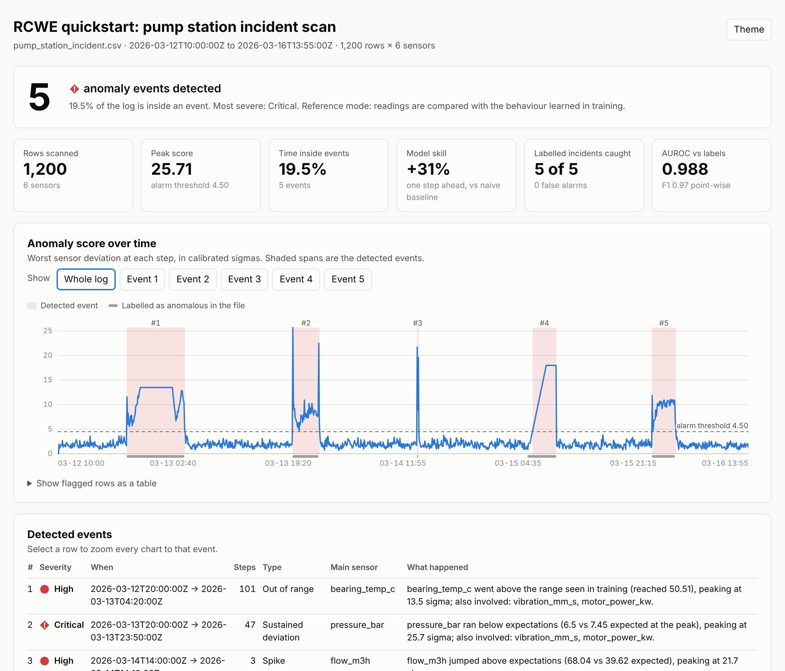
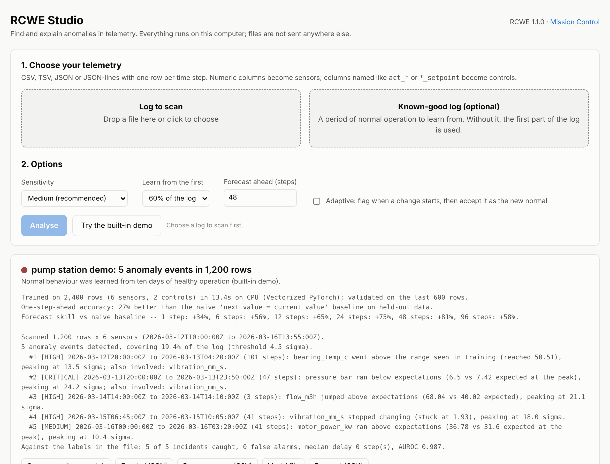
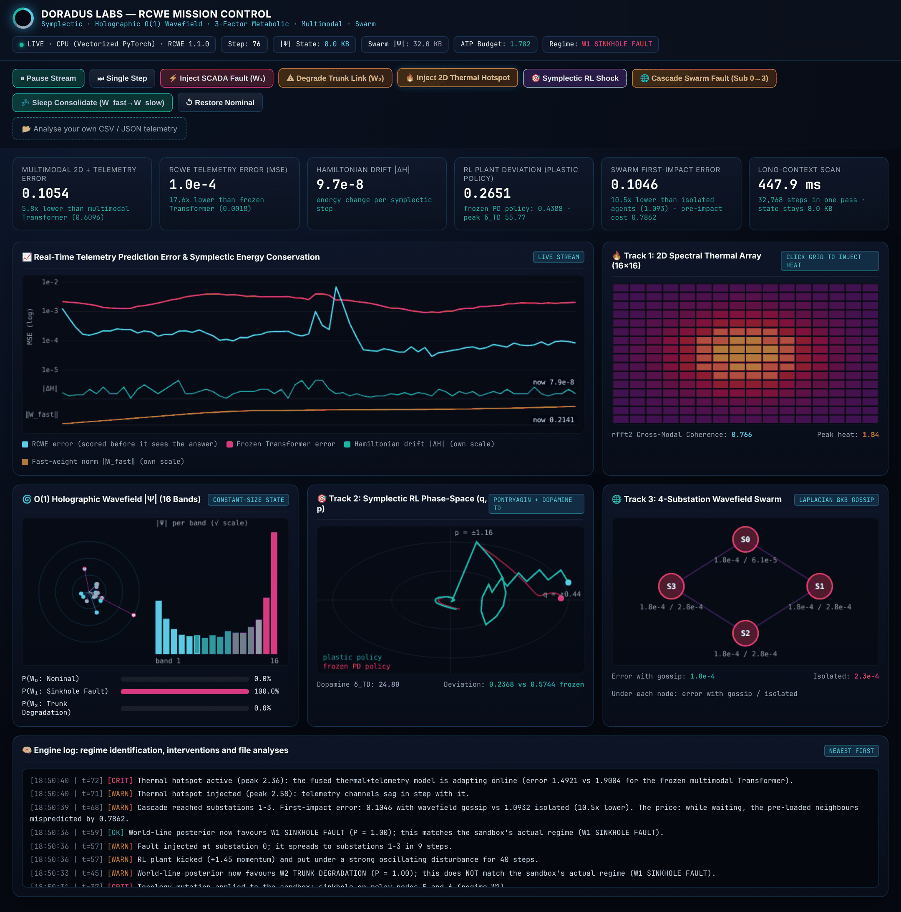

# Resonant Causal World Engine (RCWE)

[](CHANGELOG.md)
[](pyproject.toml)
[](pyproject.toml)
[](LICENSE)

**Point RCWE at a telemetry log and it tells you what went wrong, when, on which sensor, and what
it expected instead. Then it forecasts what comes next.**

Underneath is the Resonant Causal World Engine, an experimental world model from **Doradus Labs**
built on complex phase-space wavepackets, a constant-size standing wavefield, symplectic
integration and backprop-free online plasticity. On top of it sits a toolkit that makes the engine
usable in five lines of Python or one shell command.



---

## Try it in a minute

```bash
git clone https://github.com/stevegolter-Doradus-Labs/rcwe.git
cd rcwe
python3 -m venv .venv && source .venv/bin/activate
python -m pip install -e .
```

```bash
rcwe quickstart
```

`rcwe quickstart` writes a demo dataset (a pump station with six sensors and five planted faults),
learns normal behaviour, scans the incident log, forecasts ahead, and opens an interactive report.
It takes about 20 seconds on a laptop CPU. No GPU is needed.

```text
5 anomaly events detected, covering 19.5% of the log (threshold 4.5 sigma).
  #1 [HIGH] 2026-03-12T20:00:00Z to 2026-03-13T04:20:00Z (101 steps): bearing_temp_c went above the range seen in training (reached 50.51) ...
  #2 [CRITICAL] 2026-03-13T20:00:00Z to 2026-03-13T23:50:00Z (47 steps): pressure_bar ran below expectations (6.5 vs 7.45 expected at the peak) ...
  #3 [HIGH] 2026-03-14T14:00:00Z to 2026-03-14T14:10:00Z (3 steps): flow_m3h jumped above expectations (68.04 vs 39.62 expected) ...
  #4 [HIGH] 2026-03-15T06:45:00Z to 2026-03-15T10:05:00Z (41 steps): vibration_mm_s stopped changing (stuck at 1.93) ...
  #5 [HIGH] 2026-03-16T00:00:00Z to 2026-03-16T03:25:00Z (42 steps): motor_power_kw ran above expectations (36.78 vs 31.49 expected at the peak) ...
Against the labels in the file: 5 of 5 incidents caught, 0 false alarms, median delay 0 step(s), AUROC 0.988.
```

Something not working? `rcwe doctor` checks Python, PyTorch and your accelerator, runs an
end-to-end test, and tells you how to fix whatever it finds.

---

## Use it on your own data

Any CSV, TSV, JSON or JSON-lines file with one row per time step works. Numeric columns become
sensors; a timestamp column is found automatically; columns named like `act_*`, `u_*`, `ctrl_*`,
`cmd_*` or `*_setpoint` are treated as control inputs. Gaps, decimal commas and thousands
separators, day-first dates, Unix timestamps, shuffled rows, status flags and running totals are
handled, and every decision is listed for you (`rcwe inspect your_log.csv`).

### From the command line

```bash
rcwe analyze your_log.csv --open
```

One file in; an interactive report, per-row scores, a JSON list of events and a reusable model out
(in `./rcwe_output/your_log/`). If you have a log of known-good operation, pass it for sharper
results:

```bash
rcwe analyze today.csv --train normal_week.csv --forecast 48 --open
```

Train once, reuse on every new log, and follow a file that is still being written:

```bash
rcwe fit normal_week.csv -o plant.rcwe
```

```bash
rcwe detect today.csv -m plant.rcwe --report today.html --fail-on-anomaly
```

```bash
rcwe watch live.csv -m plant.rcwe --jsonl alerts.jsonl
```

### From Python

```python
from rcwe import TelemetryModel

model = TelemetryModel().fit("normal_week.csv")        # learn what "normal" looks like
result = model.detect("today.csv")                      # find and explain anomalies
print(result.summary())
result.to_html("report.html")

forecast = model.forecast(steps=48, data="today.csv")   # look ahead, with intervals
model.save("plant.rcwe")                                # reuse: TelemetryModel.load("plant.rcwe")
```

`fit`, `detect` and `forecast` also accept lists of dicts, dicts of columns, NumPy arrays and
pandas DataFrames. For live feeds, `model.stream()` scores one reading at a time.

### In the browser

```bash
rcwe serve
```

RCWE Studio runs on your own machine: drop a file on the page, pick a sensitivity, get the report
and downloads. Nothing is uploaded anywhere else.



The full reference, including every command, option and API call, is in the
**[User Guide](docs/USER_GUIDE.md)**. Runnable scripts are in [`examples/`](examples/).

---

## What you get

| | |
|---|---|
| **Explained events** | Each anomaly comes with its time span, severity, the sensors responsible, the direction of the deviation and actual-versus-expected values. |
| **Four complementary checks** | Sudden jumps, small-but-persistent drift, readings outside anything seen in training, and stuck sensors. |
| **A report you can send** | One self-contained HTML file: timeline, zoomable events, per-sensor charts, forecast, light and dark themes. Opens offline. |
| **Forecasts with honest intervals** | Intervals come from backtests on held-out data. Where the model has no skill for a sensor, the forecast falls back to "it holds its latest value" and says so. |
| **Controls you can plan with** | Declare setpoints or schedules as commands (`--commands`) and the model learns how the sensors respond: forecasts follow a planned change, and an event that begins as a control moves says so. |
| **A measure of trust** | Every model reports its accuracy against the naive "next value = current value" baseline, per sensor, on data it was not trained on. |
| **Two modes** | *Reference* compares against learned normal behaviour, so an abnormal period stays flagged. *Adaptive* uses the engine's online plasticity to flag the onset of a change and then accept the new normal. |
| **Integration hooks** | Exit status for scripts and CI (`--fail-on-anomaly`), JSON and CSV exports, JSON-lines alerts from `rcwe watch`, a single-file model format loaded with PyTorch's safe loader. |

### How it works, and where it does not

Each sensor reading is paired with its rate of change, giving the phase-space state the engine was
designed around. The engine learns to predict the next state from the current one and the control
inputs; anomalies are places where reality and prediction part ways, scored in calibrated sigmas.

- Predictions are always made **before** the engine sees the true next value. A missing reading
  is never scored, and never filled in with what came after it.
- Calibration uses rows held out from training, with statistics that a few wild readings in the
  log cannot move.
- Where the engine does not beat the naive baseline for a sensor, its prediction is shrunk toward
  that baseline rather than trusted.
- A control column might be a controller reacting to the sensors, so by default the model is
  never told a control's value for the reading it is predicting. Controls you declare as commands
  are used in full.

Things to know before relying on it:

- **Train on normal operation.** Anomalies inside the training period are partly learned as normal;
  the tool still finds where they start and stop but under-reports their duration.
- **Short logs give indicative results.** Below 80 rows there is nothing to hold back for
  calibration, and the report says so.
- **Rows are treated as evenly spaced.** Irregular sampling is noted but not resampled.
- **The model looks one step back.** It uses each sensor's level and rate of change, not long
  seasonal history, so forecasts are most useful over short horizons. Check the per-sensor skill in
  your report.
- **Controls need declaring.** Until a control is declared as a command, a planned change in it
  does not move the forecast, and a large setpoint step can raise an event (which then names the
  control that moved).

---

## Mission Control

```bash
rcwe ui
```

A live dashboard of the engine running on its built-in sandbox next to a frozen Transformer
baseline. Every curve and figure is computed on each tick by the real modules, and the buttons act
on the simulation: inject a sinkhole or trunk fault and watch the world-line posterior respond,
paint heat onto the thermal grid, shock the RL plant, start a cascading swarm fault, trigger sleep
consolidation. Drop a telemetry file on the page to analyse it.



---

## The engine

RCWE explores four ideas, each a module you can use on its own:

| Idea | Module | What it does |
|---|---|---|
| Phase-space wavepackets | `rcwe/core/wave_codec.py` | Encodes observations as complex amplitude/phase vectors. |
| Constant-size standing wavefield | `rcwe/core/resonance.py`, `rcwe/kernels/` | Summarises an arbitrarily long history in a fixed-size complex state (8 KB per stream at the default size), computed in one vectorised pass. |
| Symplectic world-lines | `rcwe/core/symplectic.py` | Evolves several candidate "world-lines" with a reversible leapfrog integrator on learned Hamiltonians, and can pick the intervention that best tells them apart. |
| Backprop-free plasticity | `rcwe/core/metabolic.py` | Adapts fast weights online from prediction error, gated by an energy budget, with an offline consolidation step. |

`ResonantCausalWorldEngine` (`rcwe/core/engine.py`) combines them; research tracks build on it
(self-healing control, a byte-level language model, 2-D multimodal fusion, symplectic RL, a
wavefield swarm).

### Measured results

Run with this release on a 4-core Linux CPU (PyTorch 2.15). The complete tables, definitions and
caveats are in **[docs/BENCHMARKS.md](docs/BENCHMARKS.md)**, which is generated by
`make benchmarks` so you can reproduce it on your own hardware.

| Benchmark | Result |
|---|---|
| Toolkit on the demo data (5 datasets x 5 planted faults) | 25 / 25 faults caught, 25 / 25 attributed to the right sensor, 0 false alarms, AUROC 0.99 |
| Toolkit forecast skill vs naive baseline (held-out rows, same 5 datasets) | +29% to +31% one step ahead, +79% to +92% at 48 steps |
| Toolkit forecast response to a planned control change (3 datasets) | 87% of the plant's true response with the controls declared as commands; 0% without |
| Engine vs frozen Transformer after a topology mutation (3 seeds) | 106x lower MSE (0.00074 vs 0.0778), unchanged when the engine is scored before it sees the answer |
| Energy drift of predictions vs the Transformer | 2.3x lower |
| Regime identification on fresh rollouts | 100% over 3 seeds |
| One pass over 32,768 steps | about 1 s; the carried state stays 16 KB (batch of 2) at every length |
| Regime-shift suite (synthetic ETT / SWaT / NASA-style logs) | 43x / 1.6x / 30x lower post-shift MSE than the frozen Transformer |
| Symbolic conservation, code-trace prediction | On par with the Transformer (1.0x and 1.1x) |

Two things to keep in mind when reading these:

- The Transformer baseline's weights are frozen at deployment while the engine adapts online. The
  large ratios measure the value of **online adaptation**, not a claim that the architecture
  out-predicts a model that is also allowed to adapt.
- Earlier releases quoted larger numbers for several rows (for example 14.5x on code-trace and
  73x on the SWaT-style log). Those were measured against a weaker, non-residual Transformer
  baseline that v0.9 replaced. The author's original Apple Silicon outputs are kept in
  [`docs/reference_results/`](docs/reference_results/).

```bash
rcwe bench --list
```

---

## Repository layout

```text
rcwe/
├── toolkit/            the end-user layer
│   ├── table.py        robust CSV/JSON/array ingestion and schema inference
│   ├── model.py        TelemetryModel (fit / detect / forecast / save / load), StreamMonitor
│   ├── scoring.py      calibrated scores, events, detection metrics
│   ├── report.py       self-contained HTML report
│   ├── studio.py       local web app (RCWE Studio + Mission Control server)
│   ├── demo.py         built-in labelled demo data
│   └── doctor.py       installation checks
├── main.py             the `rcwe` command
├── core/               engine: wave codec, resonance, symplectic block, plasticity
├── kernels/            vectorised scan, Metal shader, device selection
├── ui/                 Mission Control page and the live engine behind it
├── benchmarks/, diagnostics/, symbolic/, control/, lm/, multimodal/, rl/, swarm/
│                       research tracks and their benchmark harnesses
└── ingestion/, server/, cli.py, predict_cli.py
                        earlier entry points, kept working
docs/                   User Guide, benchmarks, reference results, verification records
examples/               runnable scripts and sample data
tests/                  automated tests (`make test`)
```

Everything RCWE generates (reports, dashboards, checkpoints) goes to `./rcwe_output/`, or to the
folder named by the `RCWE_OUTPUT_DIR` environment variable.

## Development

```bash
python -m pip install -e ".[dev]"
```

```bash
make test
```

`make help` lists every shortcut. `make fast` is a smoke test that takes a few seconds; the full
suite (about 140 tests) takes several minutes on a laptop CPU.

## Citation

```bibtex
@software{golter2026rcwe,
  author       = {Golter, Steve and {Doradus Labs}},
  title        = {{Resonant Causal World Engine (RCWE): A Non-Autoregressive Symplectic, Holographic, and Metabolically Plastic World Model}},
  year         = {2026},
  version      = {1.1.0},
  publisher    = {Doradus Labs}
}
```

Licensed under [Apache 2.0](LICENSE).
